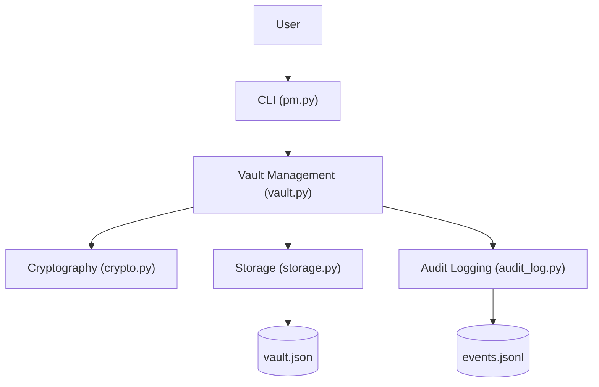

# ICS0022 Password Manager — Architecture and Threat Model

## Scope

A local, single-user command-line password manager written in Python. All entries live in one encrypted vault. No account database, network services or custom cryptographic algorithms.

## Architecture

Fresh vault begins with user-supplied master password, random salt, Argon2id, and AES-256-GCM encryption
of an empty entry collection. Unlocking reads and validates ciphertext and metadata, derives a key, 
authenticates and decrypts, validates record content, and constructs a session. Record CRUD methods 
check session authorization and field validity. Modifying operations immediately encrypt and persist updated collection. 
Locking clears session references and overwrites mutable key buffer.

Concurrent vault modifications are protected by cross-process file lock. Vault revision is checked while holding lock before publishing updated encrypted vault.
Retrieved passwords are copied to the clipboard and automatically cleared on a best-effort basis after 30 seconds, on lock or on application exit.

## Assets and protection goals

Master password, derived key, decrypted record contents, encrypted vault, and log integrity. 
Required goals: confidential credentials at rest; detect vault tampering; prevent access after failed 
authentication/lock; limit exposure in logs/interface; protect against malformed input and 
unsafe filesystem operations.

## Threat model

| Threat | Entry point | Control |
|---|---|---|
| Master password leaked via terminal | CLI authentication | Hidden input using `getpass`; input is rejected if echo cannot be disabled |
| Offline guessing against stolen vault | Local vault file | Argon2id, random salt and minimum 15-character length for new master passwords |
| Reading vault file | Local filesystem | AES-256-GCM, POSIX `0700` directory and `0600` file |
| Tampering with ciphertext or metadata | Vault file | AES-GCM authentication and metadata AAD |
| Malformed vault / oversized input | Vault parser | Exact schemas, duplicate JSON field rejection, size limits, fixed KDF parameters and handling of excessive JSON nesting |
| Unsafe file path / symlink attack | Local filesystem | File type, ownership and permission checks; `O_NOFOLLOW` where available |
| Malicious special files | Local filesystem | `O_NONBLOCK` where available and regular-file validation |
| Interrupted update | Vault save | Temporary file, `fsync` and atomic replacement |
| Concurrent writes / lost changes | Vault save | Cross-process file locking and vault revision validation |
| Unauthorized record operation | CLI / session | Every record operation requires an unlocked authenticated session |
| Sensitive error and log content | Interface / log | Generic CLI errors and fixed-schema events without secrets |
| Secrets retained in memory | Unlocked process | Best-effort key zeroization and release of references |
| Clipboard compromise | Clipboard | Automatic cleanup after 30 seconds, on lock and exit; digest-based content verification |
| Vulnerable dependencies | External libraries | Established cryptographic libraries, dependency updates and pip-audit analysis |

## Cryptographic choices

- KDF: Argon2id (`argon2-cffi`), 16-byte salt, 3 time cost, 65536 KiB memory cost, parallelism 2.
- AEAD: AES-256-GCM (`cryptography`), 12-byte randomly generated nonce on each encryption.
- Key size: 32 bytes. Vault format: JSON metadata + Base64 ciphertext and 16-byte GCM authentication tag.
- AAD: sorted, compact JSON of version, algorithm and KDF parameters, salt, and nonce.
- Master password and derived key are never intentionally saved to disk.
- New master passwords must contain at least 15 characters.
- SHA-256 is used for vault revision checking and clipboard content verification, not for master-password hashing.

## Trust boundaries and limitations

Terminal, application process, clipboard and local filesystem are separate trust zones.

Application is designed for a single local OS user. Access control is enforced through authenticated sessions and POSIX filesystem ownership and permissions. Separate application accounts and per-record ownership tables are outside the project scope.

Protection at rest assumes that attacker cannot inspect authenticated user's live process memory or capture keystrokes.

Python cannot reliably erase immutable string and byte objects. Mutable session-key buffers are overwritten on lock and master-password rotation.

Clipboard cleanup reduces exposure period but cannot guarantee removal from clipboard history or third-party clipboard managers.

Cross-process file locking prevents concurrent writes between cooperating application instances. External modifications that ignore the locking mechanism remain a residual risk.

Windows ACLs are not independently validated. Audit logging is best-effort.

See [report.md](report.md) for testing and detailed security analysis.
