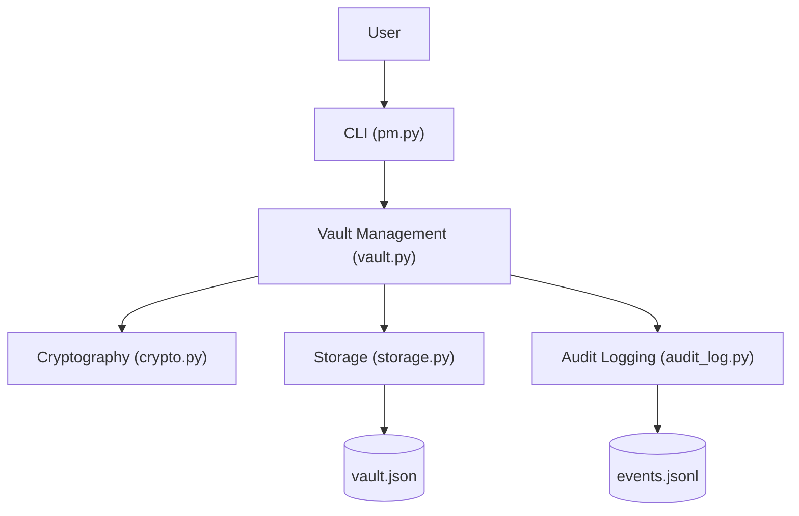

# ICS0022 Password Manager — Architecture and Threat Model

## Scope

A local, single-user command-line password manager written in Python. All entries live in one encrypted vault. No account database, network services or custom cryptographic algorithms.

## Architecture

## Architecture

Fresh vault begins with user-supplied master password, random salt, Argon2id, and AES-256-GCM encryption
of an empty entry collection. Unlocking reads and validates ciphertext and metadata, derives a key, 
authenticates and decrypts, validates record content, and constructs a session. Record CRUD methods 
check session authorization and field validity. Modifying operations immediately encrypt and persist updated collection. 
Locking clears session references and overwrites mutable key buffer.

## Assets and protection goals

Master password, derived key, decrypted record contents, encrypted vault, and log integrity. 
Required goals: confidential credentials at rest; detect vault tampering; prevent access after failed 
authentication/lock; limit exposure in logs/interface; protect against malformed input and 
unsafe filesystem operations.

## Threat model

| Threat | Entry point | Control |
|---|---|---|
| Master password leaked via terminal | CLI authentication | `getpass`; hidden input |
| Offline guessing against stolen vault | Local vault file | Argon2id and salt; risk of weak passwords remains |
| Reading vault file | Local filesystem | AES-256-GCM, POSIX `0700` directory and `0600` file |
| Tampering with ciphertext or metadata | Vault file | AES-GCM authentication and metadata AAD |
| Malformed vault / oversized input | Vault parser | Exact schemas, no duplicate JSON fields, size bound, fixed KDF parameters |
| Unsafe file path/symlink attack | Local filesystem | Type/owner/mode checks, `O_NOFOLLOW` where available, private directory |
| Interrupted update / lost changes | Vault save | Temporary file, `fsync`, atomic replace; stale content detection, no full lock |
| Unauthorized record operation | CLI/session | Every operation requires unlocked `VaultSession`; single local user only |
| Sensitive error and log content | Interface/log | Generic CLI errors, fixed-schema events without payloads |
| Secrets retained in memory | Unlocked process | Best-effort key zeroization and release of references; Python cannot guarantee full wipe |
| Clipboard compromise | Clipboard | Password is not printed; residual risk documented |

## Cryptographic choices

- KDF: Argon2id (`argon2-cffi`), 16-byte salt, 3 time cost, 65536 KiB memory cost, parallelism 2.
- AEAD: AES-256-GCM (`cryptography`), 12-byte randomly generated nonce on each encryption.
- Key size: 32 bytes. Vault format: JSON metadata + Base64 ciphertext and 16-byte GCM authentication tag.
- AAD: sorted, compact JSON of version, algorithm and KDF parameters, salt, and nonce.
- Master password and derived key are never intentionally saved to disk.

## Trust boundaries and limitations

Terminal, application process and local filesystem are separate trust zones. 
Protection at rest assumes attacker cannot read live user's process memory, keystrokes or clipboard. 
Design is for a **single local OS user**. POSIX checks do not validate Windows ACLs. 
Python cannot reliably erase immutable string/bytes objects. See [report.md](report.md) for testing and security analysis.
